# Assignment 1: VPC & Networking

Built a custom network from scratch on AWS: a VPC with public and private subnets, correct routing, and EC2 instances secured so the private one is only reachable through a bastion host.

## Architecture

## What I built

- Custom VPC (`aws-vpc`)
- Two subnets: one public, one private
- Internet Gateway and NAT Gateway (with Elastic IP)
- Two route tables: public (via IGW) and private (via NAT Gateway)
- Two EC2 instances: one public, one private
- Two security groups: public and private
- Bastion host to access the private EC2
- CloudWatch monitoring on the public EC2

## Step by step

### 1. Create the VPC
Created the VPC and named it `aws-vpc`.

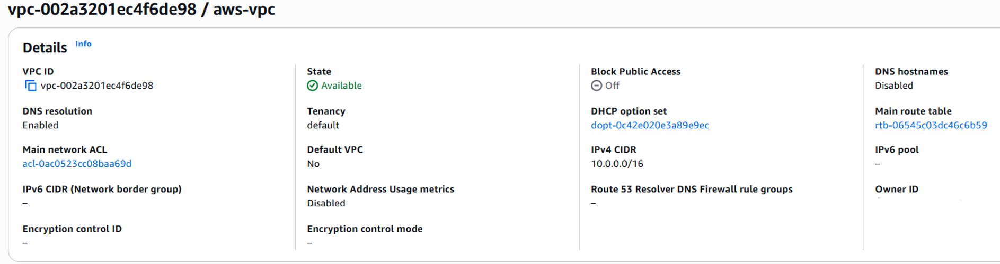

### 2. Create the subnets
Created two subnets: `aws-vpc-public-subnet-01` and `aws-vpc-private-subnet-01`.

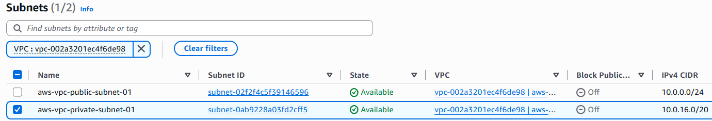

### 3. Internet Gateway
Created the Internet Gateway (`aws-vpc-igw`) and attached it to the VPC.

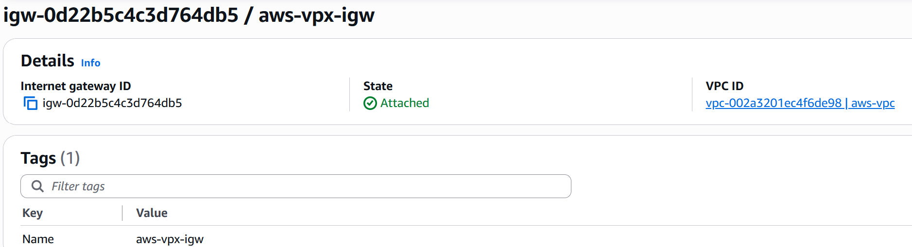

### 4. Elastic IP and NAT Gateway
Allocated an Elastic IP, then created the NAT Gateway and placed it in the public subnet.

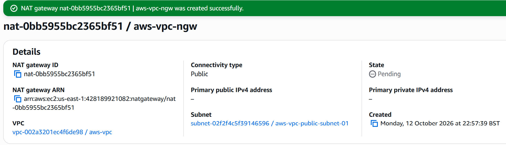

### 5. Route tables
Created two route tables, one public and one private, and associated each with its matching subnet.

- Public route table: default route (`0.0.0.0/0`) to the Internet Gateway
- Private route table: default route (`0.0.0.0/0`) to the NAT Gateway

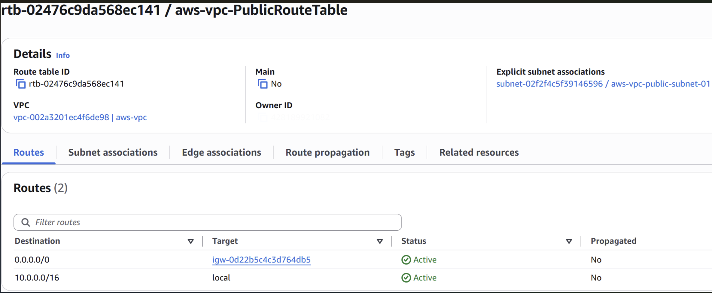
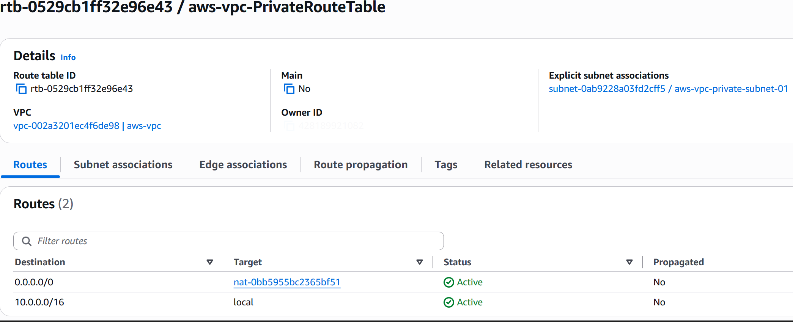

### 6. Public security group
Created `aws-vpc-ssh-http-sg` in `aws-vpc`. Inbound SSH and HTTP are allowed only from my public IP. Outbound is set to all traffic.

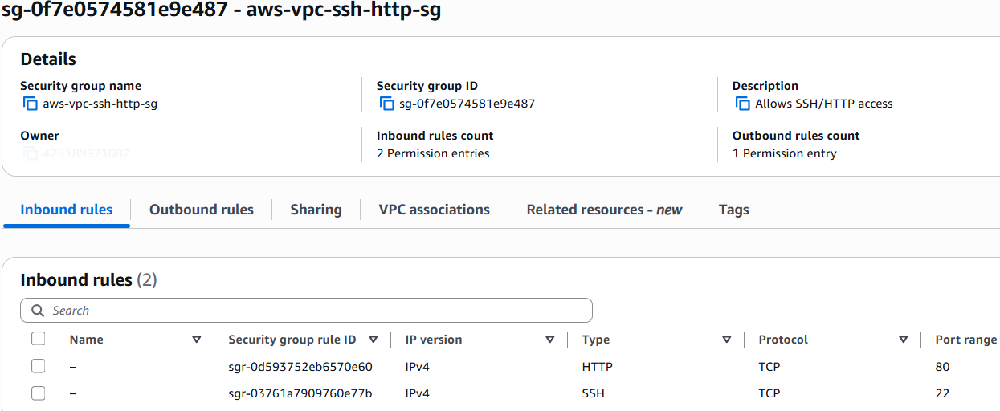

### 7. Public EC2 instance
Launched the public EC2 in the public subnet with auto-assign public IP enabled and the security group above attached.

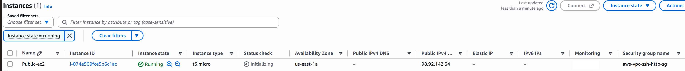

### 8. Private security group
Created a second security group for the private EC2. SSH is only allowed from the public EC2's security group (used as the source), not from an IP address.

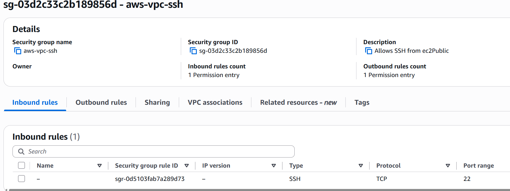

### 9. Private EC2 instance
Launched the private EC2 in the private subnet with no public IP.

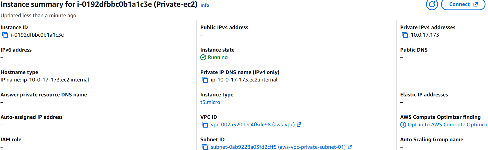

### 10. Bastion host
Created a bastion instance in the public subnet so the private EC2 can be reached through a single, controlled entry point.

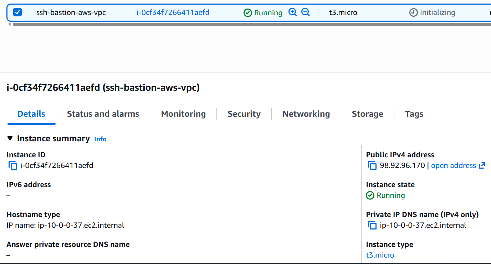

### 11. CloudWatch monitoring
Enabled CloudWatch monitoring on the public EC2.Currently have not set any notification as this is a demo. 

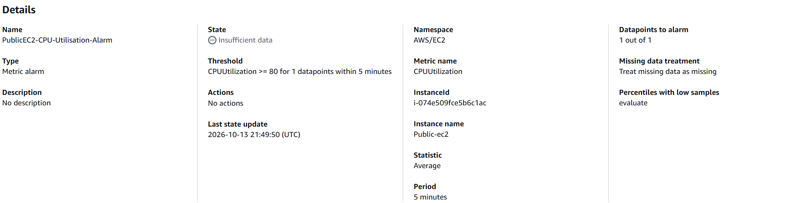

## Testing

| Test | Result |
|------|--------|
| SSH from my machine (Ubuntu) to the public EC2 | Successful |
| HTTP to the public EC2 | Timed out, as no web server was installed yet |
| SSH from my machine straight to the private EC2 | Failed, as expected |
| SSH to the public EC2, then on to the private EC2 | Successful |
| SSH to the bastion, then on to the private EC2 | Successful |

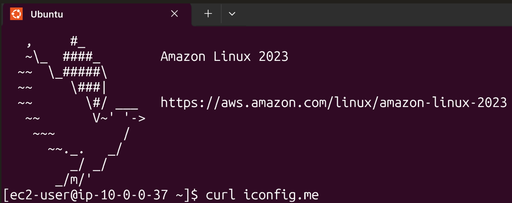
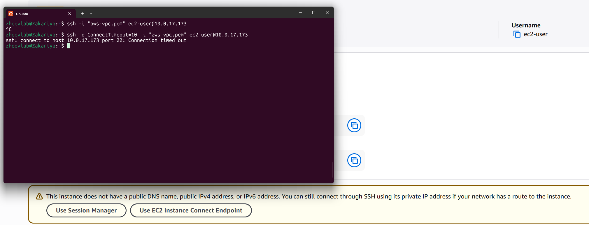
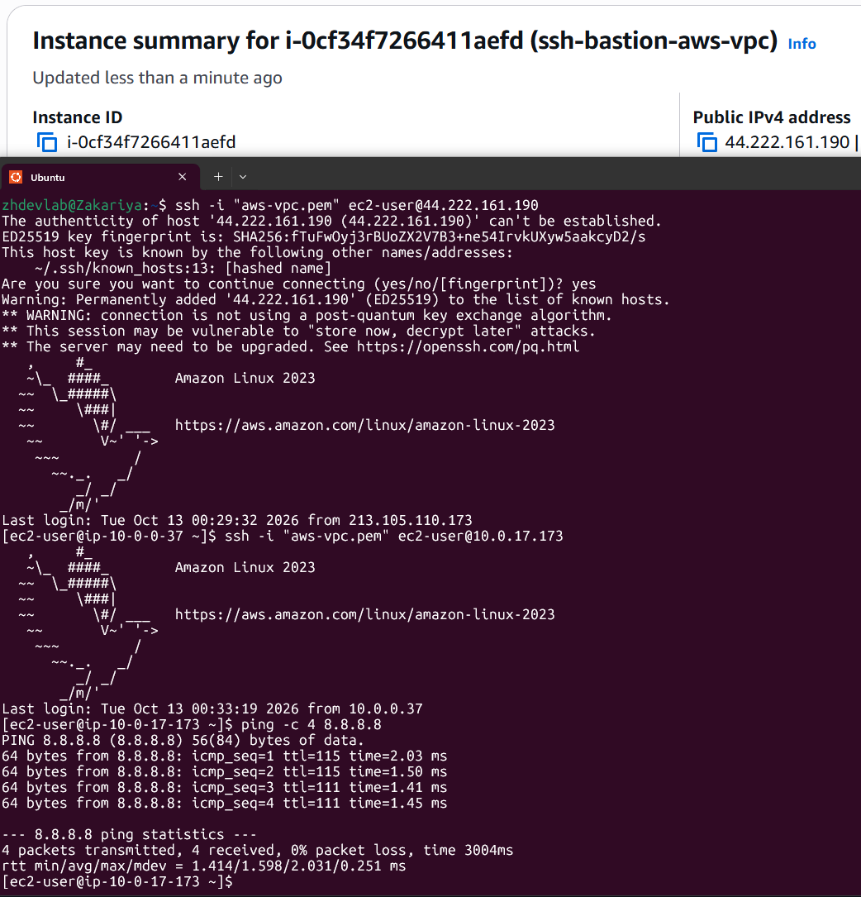

## Problems I hit and how I fixed them

**Problem:** I couldn't SSH into the private EC2 from the public EC2.

**Cause:** I had attached it to the first security group, which only allowed SSH from my own IP.

**Fix:** Created a separate security group for the private EC2, using the public EC2's security group as the source, and attached that instead.

## Clean-up and cost

To avoid ongoing charges until the next assignment, I stopped the instances, released the Elastic IP and deleted the NAT Gateway.
