# Assignment 2: Application Load Balancer

Deployed two EC2 web servers behind an Application Load Balancer (ALB). The ALB handles all incoming traffic, and the servers can't be reached directly from the internet.

Think of the ALB as a receptionist at the front desk: visitors only ever talk to reception, and reception decides which office (server) deals with them.

## Architecture


## What I built

- Two EC2 instances in different Availability Zones, each running a web server installed through user-data
- Each instance returns different content (Instance 1 and Instance 2) so load balancing is visible
- An ALB across two public subnets with an HTTP (port 80) listener
- A target group with both instances registered and a health check on set to root `/`
- Two security groups: 'aws-alb-sg' and `aws-ec2-alb-sg-1`

## Step by step

### 1. Security groups
- `aws-alb-sg`: allows HTTP (80) from anywhere
- `aws-ec2-alb-sg-1`: allows HTTP (80) only from 'aws-alb-sg`, with no direct public access

Using the ALB's security group as the source (instead of an IP range) means the servers only accept traffic that came through the load balancer.

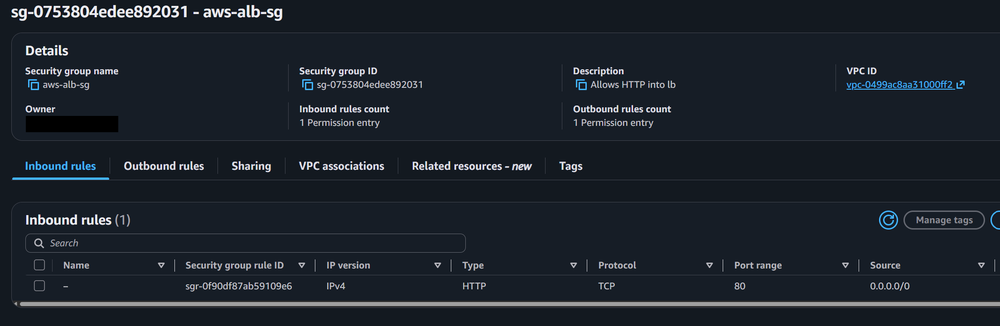
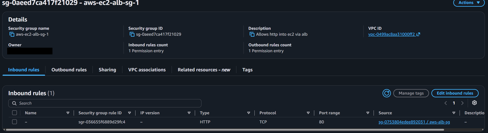

### 2. EC2 instances
Launched two instances in the same VPC but in different Availability Zones, so one AZ failing doesn't take the site down. A user-data script installs the web server and sets a different page for each instance.

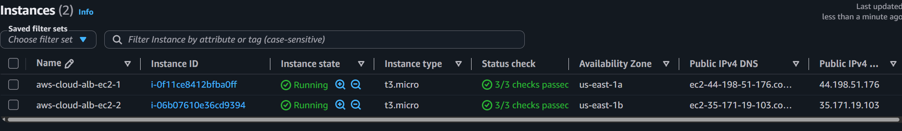

### 3. Target group and health checks
Created a target group, registered both instances, and set the health check path to root `/`.

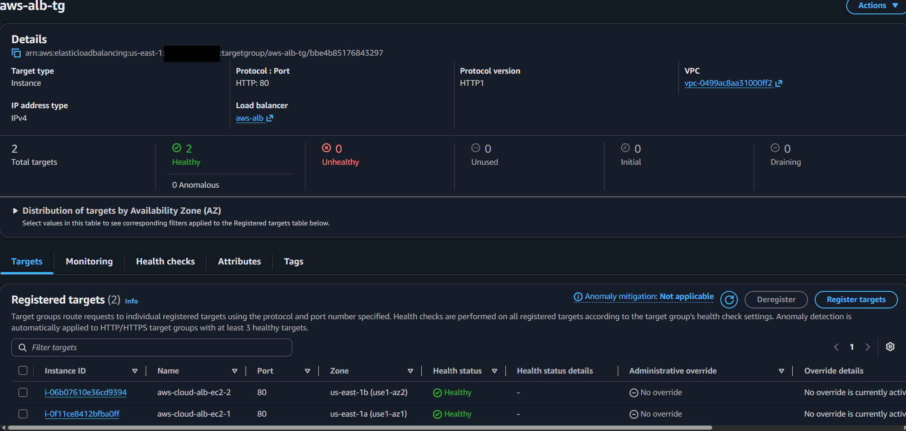

### 4. Application Load Balancer
Created an internet-facing ALB across two public subnets in different AZs, with an HTTP (80) listener forwarding to the target group.

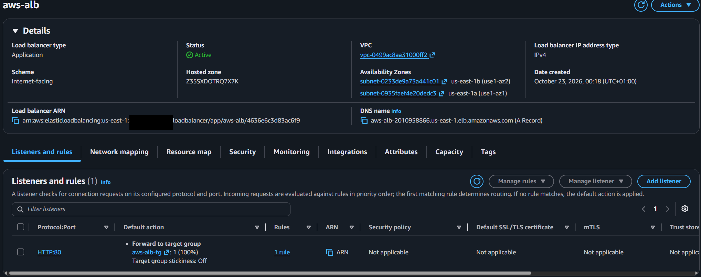

## Testing

| Test | Result |
|------|--------|
| Both targets show healthy in the target group | Successful |
| Visit the ALB DNS name and refresh repeatedly | Responses alternated between Instance 1 and Instance 2 |
| Request an instance's public IP 'http://44.198.51.176/'  directly | Timed out, so direct access is blocked |

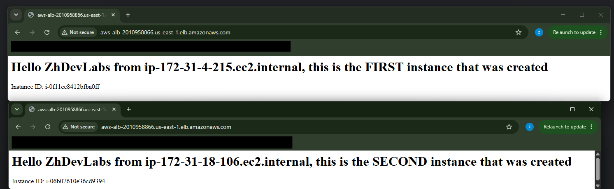
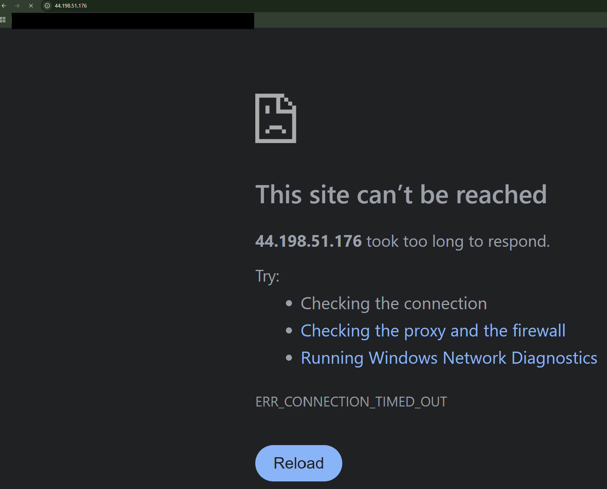

## Problems I hit and how I fixed them

I initially created the alb but it was not reachable. I had to retrace my steps and visist the secruity group where I noticed I did not specify inbound traffic, it was only set to local. I rectified it an it worked as expected.  

## Clean-up and cost

Both NAT and ALB have been deleted to stop charge.


-------------------------------------------------------------------------

## Bonus: custom domain, HTTPS and Auto Scaling

Went beyond the brief to make the setup closer to production: a custom domain with HTTPS, an ALB that only accepts traffic from Cloudflare, and an Auto Scaling Group.

```
User - Cloudflare (zakhassandev.com) - ALB (HTTPS 443) - Auto Scaling Group instances
```

### 1. Custom domain
My domain is managed in Cloudflare rather than Route 53, so I pointed a CNAME record (`@`) at the ALB's DNS name.

### 2. Lock the ALB down to Cloudflare only
Created a managed prefix list containing Cloudflare's official IPv4 ranges and used it as the source on the ALB security group for HTTP (80) and HTTPS (443). The previous open rules were removed, so nobody can bypass Cloudflare and hit the ALB directly.

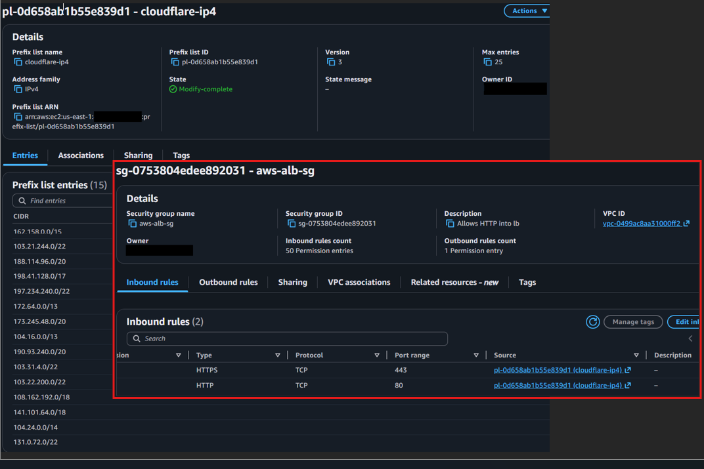

### 3. HTTPS with ACM
The domain timed out at first because the ALB had no HTTPS listener. I requested a certificate for `zakhassandev.com` in AWS Certificate Manager, added an HTTPS (443) listener forwarding to the target group, and attached the certificate.

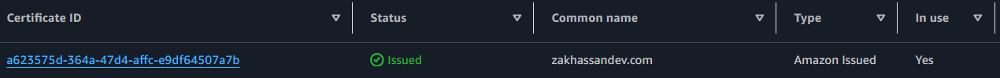


### 4. End-to-end encryption
Set Cloudflare SSL/TLS mode to **Full (strict)**, so traffic is encrypted all the way to the ALB and the certificate is validated.

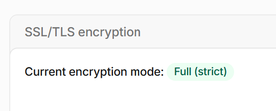
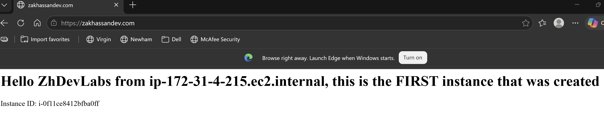

### 5. Auto Scaling Group
- Built an AMI from my configured web server (`aws-asg-launchimage`) so new instances start ready to serve
- Created a launch template (`aws-asg-template`) and a dedicated security group (`aws-asg`)
- Attached the ASG to the existing ALB target group with ELB health checks enabled, across multiple Availability Zone, this only accepts http only from the alb;s security group
- Set min/max capacity (max 5) and a target tracking policy that scales out at 85% CPU

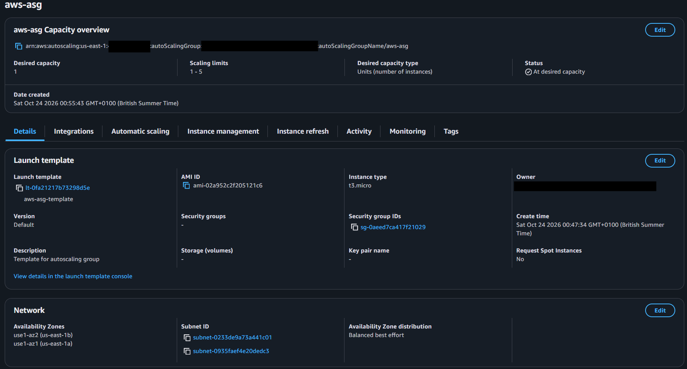
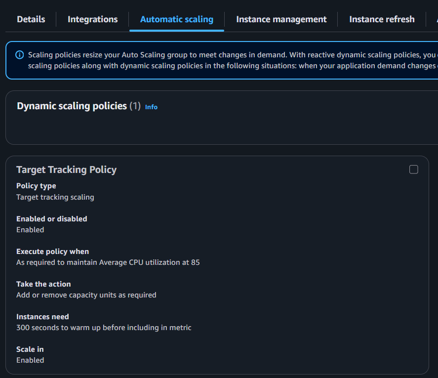
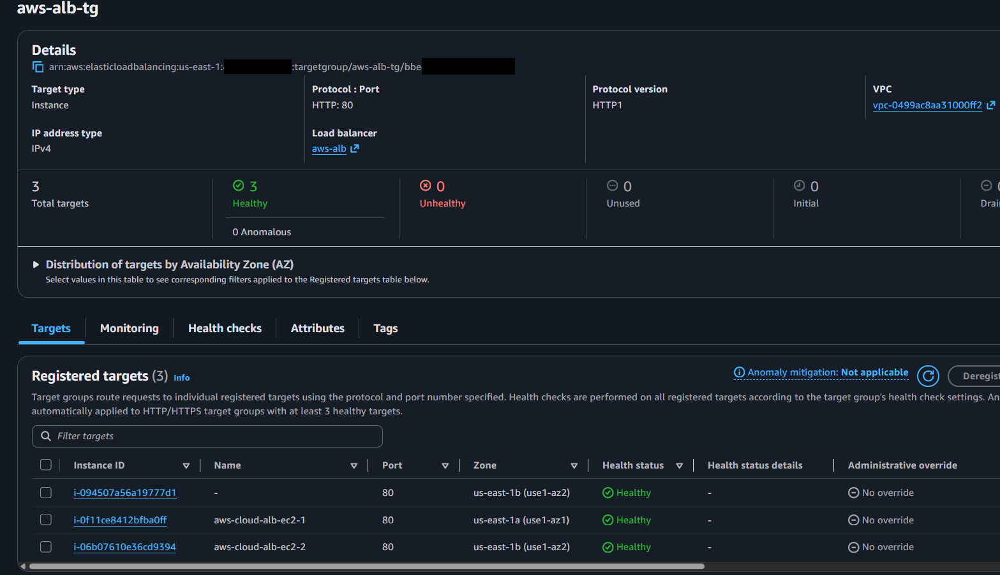

**Result:** the site is served over HTTPS on my own domain, only reachable through Cloudflare, and scales between TODO-min and 5 instances based on load.
