# Assignment 3: S3 Static Website + CloudFront CDN + Route 53 (Bonus)

Hosted a static website on S3, served it globally through CloudFront with HTTPS, and pointed a custom subdomain at it using Route 53.

User → Route 53 (aws.zakhassandev.com) → CloudFront (HTTPS) → S3 static website endpoint

## What I built

- S3 bucket with static website hosting enabled, `index.html` and `error.html` uploaded
- Bucket policy allowing public read of objects
- CloudFront distribution with the S3 website endpoint as origin, HTTPS enabled, compression on, and the managed CachingOptimized policy
- ACM certificate for the custom domain
- Route 53 hosted zone with an A record (Alias) pointing at the distribution
- My domain's DNS lives in Cloudflare, so I delegated the subdomain to Route 53 with NS records

## Step by step

### 1. S3 bucket and static hosting
Created the bucket, enabled static website hosting, uploaded `index.html` and `error.html`, and added a bucket policy making objects publicly readable.

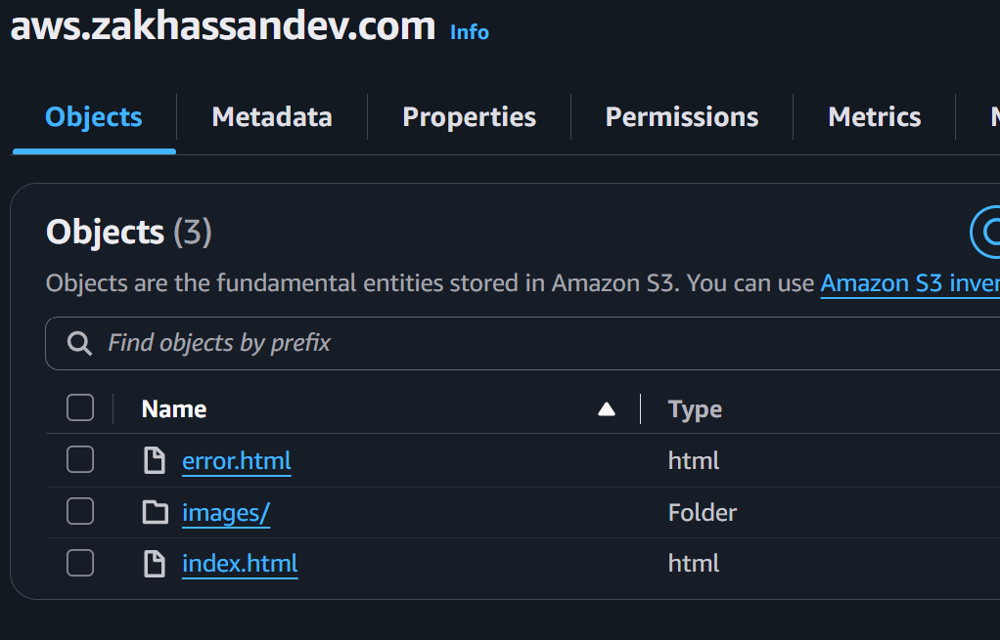
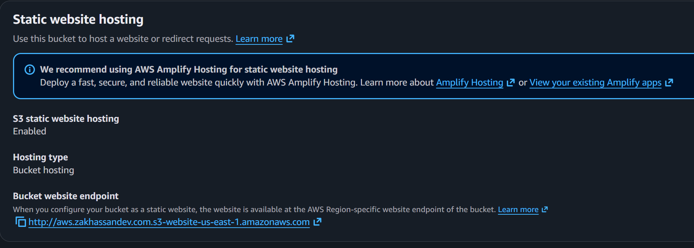
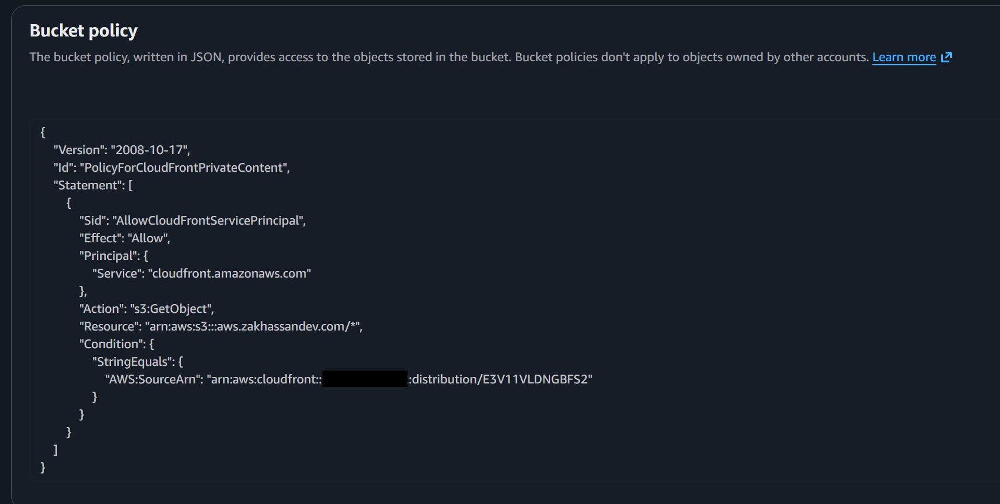

### 2. CloudFront distribution
Created the distribution with the S3 website endpoint as the origin, redirect HTTP to HTTPS, compression on, GET/HEAD allowed, and the CachingOptimized cache policy.

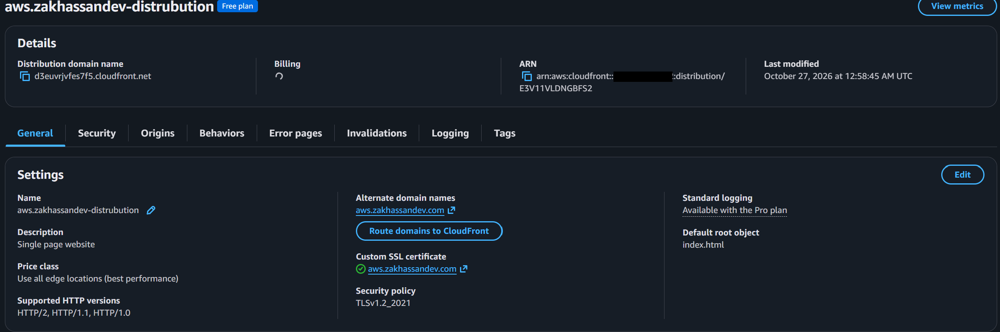

### 3. Certificate and DNS
Requested an ACM certificate and  attached it to the distribution with my domain as an alternate domain name (CNAME), then created the Route 53 hosted zone and an Alias A record pointing at CloudFront. Delegated the subdomain from Cloudflare to Route 53 with its NS records.

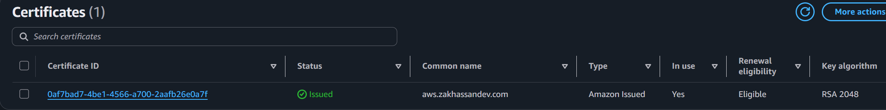
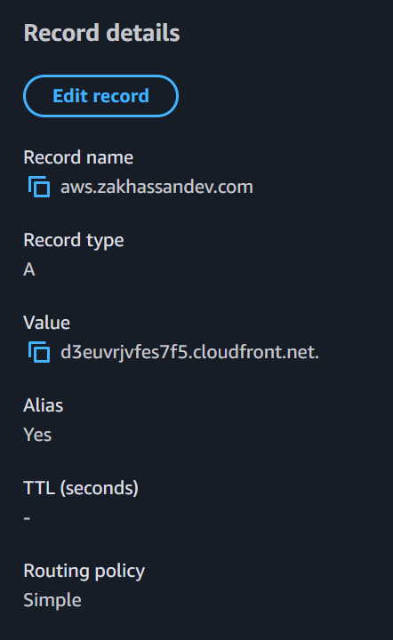
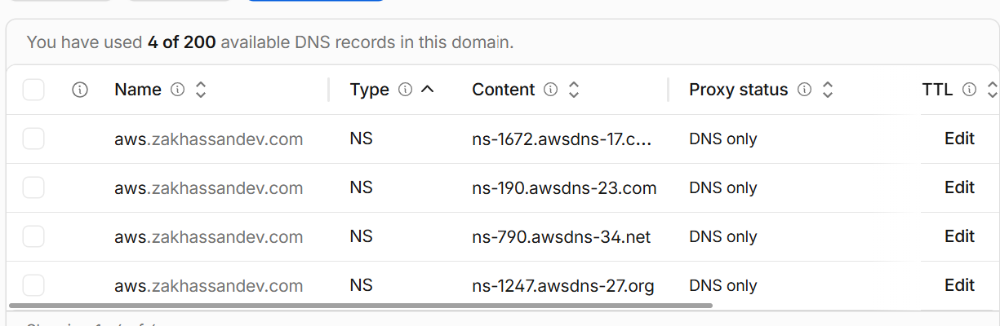

## Testing

| Test | Result |
|------|--------|
| Visited the domain over HTTPS | Served by CloudFront with a valid certificate |
| Response headers show CloudFront | `X-Cache` and `Via` headers present |
| Edit `index.html` and re-upload | Old version still served from cache |
| Create a CloudFront invalidation | New version served after it completed |

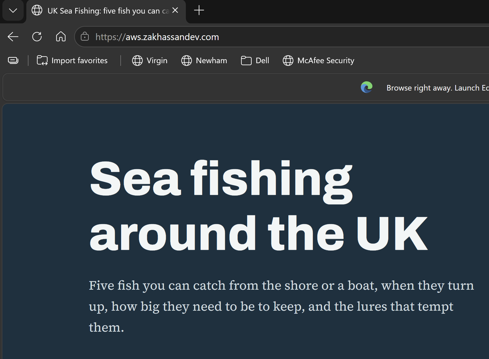
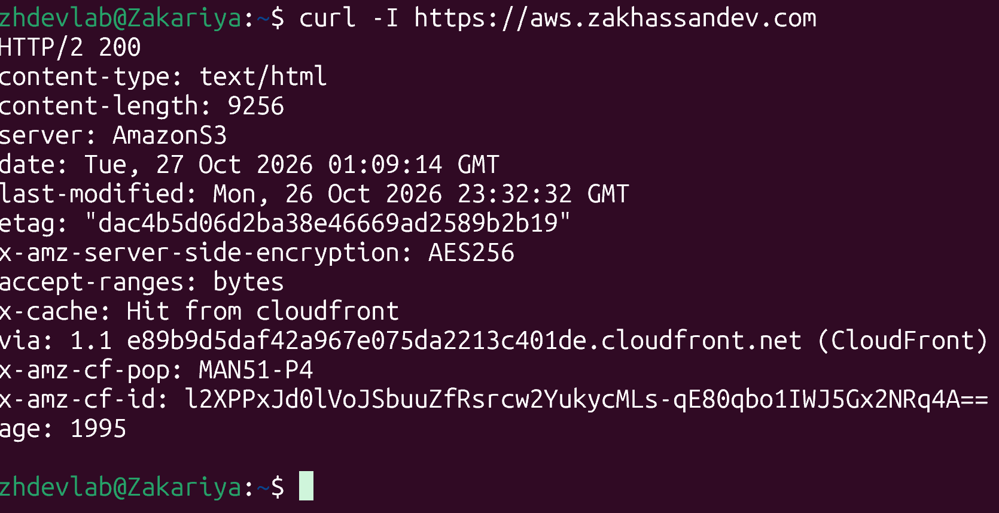
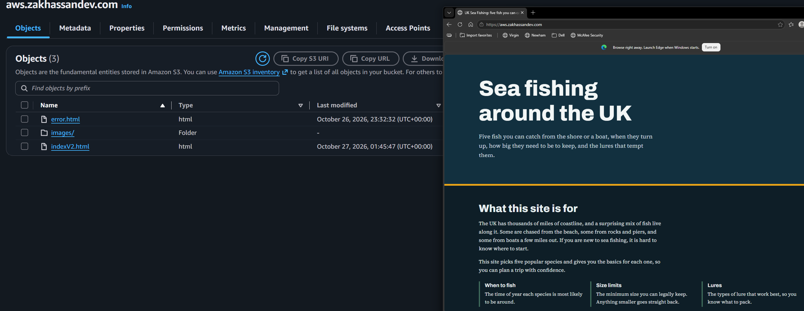
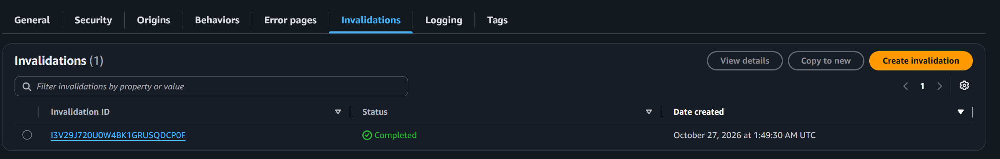
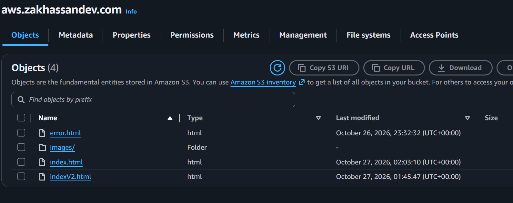

## Problems I hit and how I fixed them

Once I requested the certificate, it was stuck on pending. After a bit of research I discovered that i did not create a new record. Everytime I visited the site from CloudFront it kept on giving me a 403 error. 

I went back on the CloudFront, I created the CNAME record, went back onto Route53 and added a new CNAME record. I waited until the startus changed and tested it which I confirmed that it worked. 

## Clean-up and cost

I have deleted the following, CloudFront Distro, ACM Certificate, Route53 Zone and the S3 Bucket to avoud furher costs.

